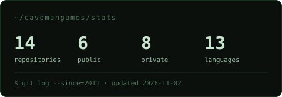
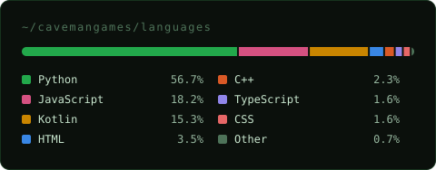

  

<h1 align="center">Cave Man's Development Studio</h1>

<b>Raw tools. Fine software.</b> 
Apps, games and systems built to order, since 2011.

  <a href="https://cavemans.app">cavemans.app</a> ·
  <a href="mailto:contato@cavemans.app">contato@cavemans.app</a>

---

### What we build

- **Android native** and **cross-platform** apps
- **Web apps and landing pages**
- **MVPs** to validate an idea before the big investment
- **Games and advergames**, from casual to VR
- **Interactive experiences for events**: we deliver the application and the exact list of equipment to rent. Rental and on-site operation stay with your supplier.
- **Embedded hardware** when the project needs a custom controller
- **Consulting, code review, maintenance and evolution** of existing systems

You talk directly to the person who writes the code.

### Where we come from

Since 2011, our founder, Luiz Augusto Melo, has built interactive experiences for brands such as Nestlé, Visa, Diageo, Cielo, Honda, Unilever, IBM and Ambev. Those projects were delivered under his previous brand, Twister Eventos. In 2026 that work became a studio.

A few of them, all with public videos:

| Year | Project | What we built |
|---|---|---|
| 2016 | [VR motorcycle simulator · Honda](https://youtu.be/pHIZPoA-l9Y) | A real motorcycle handlebar (brake, throttle, gear) turned into the controller of a VR racing game, for the 35 years of Consórcio Nacional Honda. It toured Brazil. |
| 2016 | [Virtual catalog · Schmersal](https://youtu.be/i3NPnK7UyYs) | Interactive product catalog with custom Arduino hardware, built for a trade fair in Germany. |
| 2018 | [VisaVR · Visa](https://youtu.be/0KxbwEKlTuE) | Virtual reality experience for Visa. |
| 2018 | [Quiz · Cielo](https://youtu.be/fmtXIOHAhwY) | Quiz for an event audience. |
| — | [Leite Ninho game · Nestlé](https://youtu.be/2OLRyIYaaw4) | Branded game for Nestlé's Leite Ninho. |

Our own products carry the seal **by Cave Man's**: **GlicoKids** and **EV-charger**.

### Stack

### By the numbers

Most of our code belongs to client projects, so most repositories are private. The cards below count all of them, totals only, and refresh every week.

  
  

---

<i>If it can be imagined, it can be built.</i>

